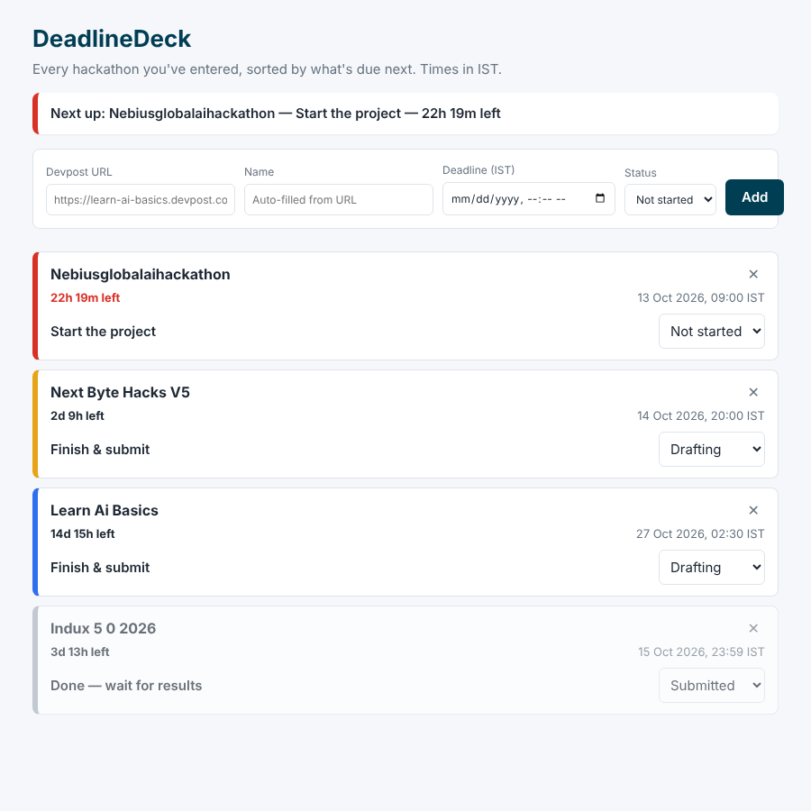

# DeadlineDeck

   [](LICENSE)

One screen showing every Devpost hackathon you've entered, sorted by what's due next. Each card shows time left in IST, its status, and the next thing to do.

Built for Devpost's **Build With AI: Basics** with the Devpost Learn Skill Pack. The planning docs are in [`devpost/`](devpost/): `scope.md`, `prd.md` and `spec.md`.

## Run
```bash
python3 -m http.server 8000   # or: npx serve .
# open http://localhost:8000
```
The page loads ES modules, so open it over http, not file://.

## Test
```bash
node --test
```

## How it works
- `logic.js`: pure functions (name from URL, IST conversion, countdown, next action, urgency, sorting)
- `app.js`: form, rendering, and saving to localStorage (`deadlinedeck.v1`)
- `style.css`: urgency colors (red < 24h, amber < 72h, blue otherwise, grey when done)



## Features
- Add a hackathon by pasting its Devpost URL; the name is filled in for you
- Deadlines shown in IST with a live countdown
- Cards sorted by what's due next, colour-coded by urgency
- A "next action" hint on every card
- Everything stays in your browser (localStorage), no account needed

## License
[MIT](LICENSE)

---
Maintained by [Swapnil Chaudhari](https://github.com/swapnilchaudhari007)
